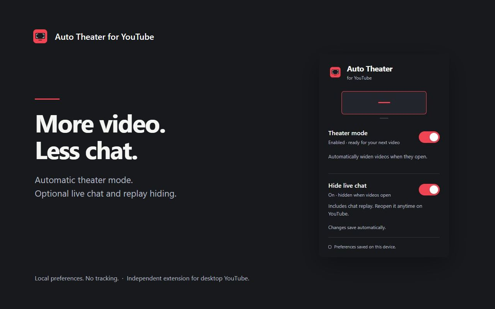

<p align="center"></p>

# YouTube Auto Theater Mode

**A wider view, automatically.** Open desktop YouTube videos in theater mode and keep control with one simple switch.

Manifest V3 · No runtime dependencies · Local preference only · No analytics



## What it does

- Opens standard YouTube watch videos in theater mode, including when you navigate between videos without reloading the page.
- Waits for the player and size button to finish loading.
- Remembers your on/off preference on this device.
- Lets you change the view manually after automatic activation. It will not keep switching you back.
- Leaves fullscreen, mini player, Shorts and embedded players alone.

**Turning it off stops automatic switching. It does not shrink the current video.** Turning it back on applies theater mode to eligible open YouTube watch tabs.

The popup shows your saved preference, not live confirmation of the current tab's layout. The extension is intended for the desktop YouTube website; it does not add theater mode to pages that lack YouTube's theater control.

## Install locally

The Chrome Web Store listing has not been published yet. You can install the unpacked extension now:

1. Download this repository using **Code → Download ZIP**, then extract it. Or clone it:

   ```sh
   git clone https://github.com/martinhuang-work/YouTube-Auto-Theater.git
   ```

2. Open `chrome://extensions` in Chrome.
3. Turn on **Developer mode** in the top-right corner.
4. Click **Load unpacked** and select the **`extension` folder** inside this project. Select the folder containing `manifest.json`, not the repository root.
5. Refresh any YouTube tabs that were open before installation.
6. Pin the extension from Chrome's Extensions menu, open a YouTube video, and use the toolbar popup to enable or pause automatic theater mode.

No `npm install`, server or compilation is required to use the extension. After changing extension code, click **Reload** on its card in `chrome://extensions` and refresh YouTube.

## Privacy and permissions

| Access | Why it is needed |
| --- | --- |
| `storage` | Save one boolean, `autoTheaterEnabled`, using `chrome.storage.local`. It defaults to enabled and is not synced by this extension. |
| Content script on `https://www.youtube.com/*` and `https://youtube.com/*` | Recognize the watch page and operate YouTube's existing theater button. Injection across the site is necessary because navigation from Home to a video may not reload the page. |

The extension makes no network requests and contains no analytics, ads, accounts, remote scripts or remote fonts. It reads the current URL/video identifier and player elements locally to decide when to act; it does not retain or transmit them. Only the enabled/paused preference is saved.

Read the [privacy policy](PRIVACY.md). YouTube's own data practices and browser services operate independently of this extension.

## How it works

The content script starts at `document_start`, listens for YouTube navigation events and caches the saved preference. On an eligible watch page, it waits for the matching player and a visible theater-size control, then clicks only if the page is not already in theater mode. A short-lived observer reacts immediately when player elements change; a timer covers changes that do not produce an observed DOM mutation. After success it disconnects, preserving your manual choices for that video.

Each activation window is limited to 20 seconds and at most three spaced clicks. New videos, explicitly re-enabling the switch, returning to an unfinished visible tab or exiting fullscreen can start an appropriate new attempt. Failed or missing controls never cause unlimited polling.

## Development and verification

Use Node.js 20 or newer. The extension and validation scripts have **zero npm dependencies**.

```sh
npm run check
npm test
npm run package
```

- `check` validates the manifest, local resources, JavaScript syntax and PNG icon sizes.
- `test` runs behavior regressions for navigation, delayed rendering, manual overrides, fullscreen, storage failures and toggle persistence.
- `package` creates `dist/YouTube-Auto-Theater-1.1.1.zip` and its SHA-256 checksum. The ZIP includes only the contents of `extension/`, with `manifest.json` at its root.

Tests use controlled page/API fixtures. They complement the [manual browser checklist](docs/TESTING.md), which must be run against live YouTube before submission and after significant YouTube layout changes. See that file for the current validation record and limits.

Optional asset regeneration requires Python 3 and Pillow:

```sh
python -m pip install Pillow
python scripts/generate-assets.py
```

The original geometric icon source is `extension/icons/mark.svg`. Committed PNGs are ready to use; regenerating them is optional.

## Project layout

```text
extension/           Load this folder in Chrome; shipped extension files only
  manifest.json      Manifest V3 and minimal permissions
  content.js         YouTube navigation and theater activation
  popup.html/css/js  Accessible on/off popup and saved-state feedback
  icons/             Original vector mark and PNG sizes
store/               Listing copy, screenshots and promotional graphics
scripts/             Validation, reproducible packaging and optional asset export
tests/               Dependency-free behavior regression tests
docs/                Publishing guide, test checklist and design notes
.github/             CI checks and review ownership
PRIVACY.md           Public privacy policy
```

## Publishing to the Chrome Web Store

Follow [PUBLISHING.md](docs/PUBLISHING.md) for the upload sequence, required assets, permission explanations, privacy answers and owner-only account steps. Ready-to-paste listing copy is in [store/LISTING.md](store/LISTING.md).

Upload the generated extension ZIP, **not** GitHub's source-code ZIP. Register the publisher account, complete any required verification, run the live-browser checklist, and submit for Google's review. This repository does not imply approval or availability in the store.

## Repository ownership and contributions

This project is maintained by [@martinhuang-work](https://github.com/martinhuang-work). Public visibility lets people inspect the source, fork it and propose changes; it does not grant write or merge access. No outside collaborators are intended to have write access. Automatic merging is not part of this project's workflow.

Bug reports are welcome through [GitHub Issues](https://github.com/martinhuang-work/YouTube-Auto-Theater/issues). Include your browser version, the kind of YouTube page and steps to reproduce. Do not post private account details, cookies or credentials. Pull requests are suggestions and may be declined; see [CONTRIBUTING.md](CONTRIBUTING.md).

## Troubleshooting

**Nothing happens:** Check that the switch is enabled, refresh YouTube after installation, and open a standard `/watch?v=…` video. Check Chrome's extension site-access setting for YouTube. Other player-layout extensions may conflict.

**A small delay before the video widens:** Version 1.1.1 starts earlier and removes the extra 250 ms wait after observed player changes. Reload the extension and refresh YouTube to use the update. YouTube must still create and initialize its player; a completely flicker-free first frame is not guaranteed.

**It stopped changing the layout after I exited theater mode:** This is intentional for the current video. Open another video or switch the extension off and on to apply it again.

**The popup reports a save/load error:** Use **Try again**. If it persists, reload the extension from `chrome://extensions`, then refresh YouTube.

**YouTube changed its layout:** Player selectors and navigation events are not a stable public API. Open an issue with reproduction steps. This extension does not circumvent playback, ads or access restrictions.

## License and attribution

No open-source license has been selected; no license file is included. The owner can add one separately. The screen icon and promotional geometry were created for this project.

This is an independent extension and is not affiliated with or endorsed by YouTube or Google. YouTube is a trademark of Google LLC.
